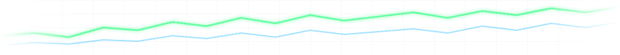

  

---

## 💼 Current Jobrole

**Data Process Coordinator | Akasa Clean Energy**
* **Data Cleaning & QA:** Cleansed and validated 1,000+ daily records, proactively flagging anomalies to guarantee high data integrity across systems.
* **Data Visualization:** Designed dynamic Google Sheets dashboards, translating complex service metrics into actionable KPIs for senior management.
* **Operational Analytics:** Analyzed ticket trends and utilized geographic data to strategically route 200+ service requests, optimizing field engineer response times.
* **Database Management:** Administered a centralized database of 150+ regional dealers to ensure seamless coordination and strict data accuracy.
* **Process Optimization:** Investigated daily reports to identify operational bottlenecks, resulting in streamlined workflows and improved service delivery.

## ⚙️ How I Turn Data into Insights

  

## 🛠 Technical Stack

<!-- NOTE: the percentages in skills-bars.svg are placeholders. Edit them to match your real level. -->

  

 

  

## 📂 Featured Case Studies

### 1. Pharma Inventory Risk & Capital Analysis
**[View Project Repository](https://github.com/Kaif39211/pharmaceutical-inventory-analysis-SQL)**
* **Objective:** Quantified capital lockup and tracked 90-day expiry risks across 35,000+ inventory records.
* **Tech:** SQL
* **Outcome:** Built query models to identify dead stock and minimize financial waste from expired inventory.

### 2. Zepto E-Commerce Margin Optimization
**[View Project Repository](https://github.com/Kaif39211/Zepto-Inventory-Optimization-SQL)**
* **Objective:** Analyzed pricing strategies and identified margin leakage for a quick-commerce dark store.
* **Tech:** SQL
* **Outcome:** Pinpointed stagnant capital and optimized inventory flow.

### 3. K.M Logistics Sales Performance Analysis
**[View Project Repository](https://github.com/Kaif39211/Analysis-Company-Data-With-Excel)**
* **Objective:** Engineered 31,000+ raw transactional records to uncover marketplace performance and fulfillment efficiency.
* **Tech:** Advanced Excel
* **Outcome:** Segmented customer demographics and highlighted regional delivery success rates to guide targeted marketing and logistics operations.

### 4. Budget Variance Analysis (Power BI)
**[View Project Repository](https://github.com/Kaif39211/Budget-variance-analysis-powerbi)**
* **Objective:** Architected a star-schema data model integrating general ledger records to automate Actual vs. Budget performance tracking across multiple departments.
* **Tech:** Power BI, DAX, Data Modeling
* **Outcome:** Segmented operating expenses (OPEX) and highlighted revenue variances to pinpoint financial inefficiencies and guide strategic corporate spending.

  

📫 **Let's Connect:** [**LinkedIn**](https://www.linkedin.com/in/kaifmahaldarofficial) &nbsp;|&nbsp; [**kaifmahaldar5@gmail.com**](mailto:kaifmahaldar5@gmail.com)
