<!-- ============================================================
     HOW TO USE
     1. Create a public repo named EXACTLY like your GitHub username.
     2. Upload ALL the .svg files to the root of that repo:
          analyst-banner.svg   data-rain-header.svg   data-pipeline.svg
          skills-bars.svg      divider-pulse.svg
     3. Paste this README.md. Keep the sections you like, delete the rest.
     ============================================================ -->

<!-- ================= HEADER: pick ONE ================= -->

<!-- HEADER A: terminal + live bar chart (default) -->

  

<!-- HEADER B: Matrix-style falling data (swap in by removing the comment markers, and remove HEADER A)

  

-->

<!-- HEADER C: wave header + typing line (no file needed)

  
  

-->

<!-- ================= DIVIDER ================= -->

  

<!-- ================= HOW I WORK ================= -->

  

 

<!-- ================= SKILL LEVELS =================
     The percentages are PLACEHOLDERS (Excel 90, Power BI 85, SQL 80, Python 75).
     Change them in skills-bars.svg so they match your real level. -->

  

 

<!-- ================= TOOL BADGES ================= -->

  
  
  
  
  
  

<!-- ================= FOOTER ================= -->

  

